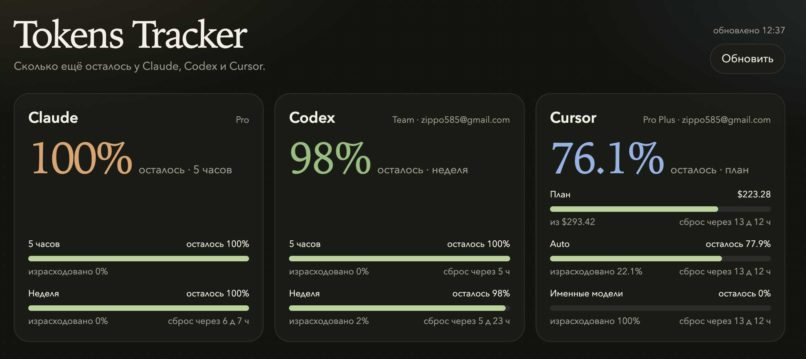

# AI Karma

Локальная страница, которая показывает, сколько лимита осталось у Claude, Codex и Cursor.

Сайт слушает только `127.0.0.1`. Токены читаются из входов, которые эти программы уже сохранили на Mac, и уходят только в их собственные API. На диск и в ответы страницы токены не пишутся.

## Запуск

```bash
npm start
```

Откройте http://127.0.0.1:8787

При первом запросе macOS может спросить разрешение прочитать связку ключей Claude Code. Это `security`, не сторонний сервер.

## Откуда цифры

- Claude — связка ключей `Claude Code-credentials` или `~/.claude/.credentials.json`
- Codex — `~/.codex/auth.json`
- Cursor — сессия в `state.vscdb` редактора

Если сессия истекла, войдите в соответствующую программу ещё раз и обновите страницу.

## Как выглядит

